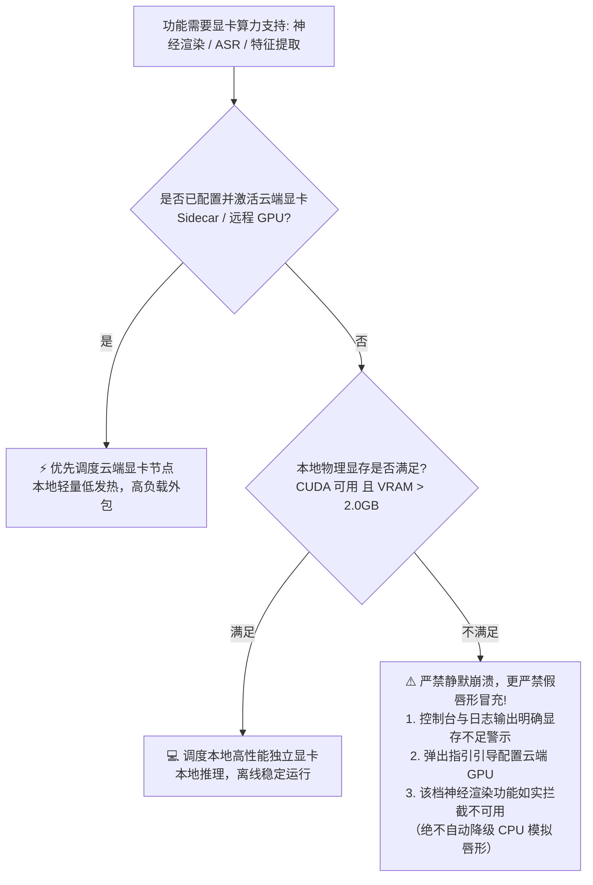

# AI-LiveStream-Agent · 专注电商带货的 7×24 小时无人值守 AI 数字人直播中枢

<div align="center">


<p align="center">
  <b>上传一段 1~2 分钟真人实拍视频，全自动切片生成专属电商带货数字人形象</b><br>
  <b>上传一段 1~2 分钟真人实录音频，全自动克隆成数字人带货主播音色</b><br>
  <b>7×24 小时无人值守带货 · 动静分离极致画质 · 毫秒级全双工语音打断 · 全平台弹幕自动场控 · 视觉抗封禁防查</b>
</p>

</div>

---

> 🎯 **【重要声明：系统核心业务定位与场景红线】**：
> 1. **唯一核心业务定位**：本项目**专为“AI 数字人无人值守直播带货”**全链路闭环深度研发（涵盖商品 SKU 货盘调度、5 大带货专属动作手势、促单逼单状态机、新广告法违禁词毫秒过滤与高意图弹幕秒级响应）。
> 2. **明确排除场景（红线规约）**：系统**严禁且不适用于“娱乐直播、才艺表演、搞笑整活、情感陪伴、纯聊天”等非卖货场景**：
>    - **技术能力不匹配**：娱乐/才艺直播的核心在于真人的即兴幽默、夸张微表情（大笑、撒娇、即兴情绪爆发）与大范围灵动肢体表演。当前数字人的“固定动作切片 + 局部神经口型重绘”在此类场景下极易被观众一眼识破为假人，留存率极低，且会被抖音、快手等平台算法直接判定为“低质录播挂机”予以**封禁账号**；
>    - **商业逻辑不闭环**：情感陪伴与纯聊天直播依赖纯打赏变现，ROI 极低，根本无法打平大模型 Token 与算力账单；
>    - **电商带货天生契合**：观众进入带货直播间的核心诉求是**“获取结构化商品信息与低价紧迫感”**（“多少钱？怎么买？身高165穿什么码？什么时候发货？”），问答高度标准化、结构化，与数字人技术天生契合，并能产生直接的 GMV 交易转化。

> 📌 **项目使用者定位说明（硬件配置重要提示）**：
> 实际情况下，过低配置的电脑无法流畅运行高拟真数字人直播，请根据自身硬件条件合理选型，避免浪费时间盲目折腾：
> 1. **本地电脑 CPU 小于 4 核的用户，不用折腾！**
> 2. **本地实时神经唇形渲染要求 CUDA 独显显存 ≥ 2GB（推荐 ≥ 6GB 流畅）**，低于该基线的用户请直接看第 3 条；
> 3. **本地电脑没有独立显卡、或显存不足、或无 CUDA 的用户，请一定配置云端 GPU（可租赁，约 1~2 元/小时）**。系统按「架构诚实」原则**禁止用 CPU 模拟假唇形冒充真实画面**：算力不足且未配置云端时，开播体检会如实拦截并指引配置云端 GPU，而不会静默降级。

---

## 目录（Table of Contents）

- [一、项目定位、愿景与核心痛点破局](#一项目定位愿景与核心痛点破局)
  - [1.1 专为电商无人值守带货而生](#11-专为电商无人值守带货而生)
  - [1.2 为什么不能用于“娱乐、才艺、情感”类直播？](#12-为什么不能用于娱乐才艺情感类直播)
  - [1.3 核心技术杀手锏：“动静分离 / 批播结合”架构 (Batch-Stream Hybrid)](#13-核心技术杀手锏动静分离--批播结合架构-batch-stream-hybrid)
  - [1.4 传统六大行业死结破局对比表](#14-传统六大行业死结破局对比表)
- [二、开发语言与技术栈全景](#二开发语言与技术栈全景)
- [三、核心优势与系统亮点](#三核心优势与系统亮点)
- [四、硬件分级与端云算力调度矩阵](#四硬件分级与端云算力调度矩阵)
- [五、系统架构与双核驱动拓扑](#五系统架构与双核驱动拓扑)
- [六、完整功能矩阵与模块清单](#六完整功能矩阵与模块清单)
  - [1. 数字人资产制作工场 (Avatar Task Engine)](#1-数字人资产制作工场-avatar-task-engine)
  - [2. 5 大电商带货动作状态机 (Action State Machine)](#2-5-大电商带货动作状态机-action-state-machine)
  - [3. 直播决策大脑与多角色 Agent 矩阵](#3-直播决策大脑与多角色-agent-矩阵)
  - [4. 电商带货商业中枢 (SKU 货盘 / 逼单 / 优惠券)](#4-电商带货商业中枢-sku-货盘--逼单--优惠券)
  - [5. 全双工实时语音闭环与极速打断系统](#5-全双工实时语音闭环与极速打断系统)
  - [6. 聚合 TTS 语音合成与 10 秒音色复刻](#6-聚合-tts-语音合成与-10-秒音色复刻)
  - [7. 全平台弹幕监听与自动场控引擎](#7-全平台弹幕监听与自动场控引擎)
  - [8. 合规风控护栏与反封禁防御体系](#8-合规风控护栏与反封禁防御体系)
  - [9. 多路推流与媒体分发矩阵 (OBS / RTMP / WebRTC / 录制)](#9-多路推流与媒体分发矩阵-obs--rtmp--webrtc--录制)
  - [10. 知识库 RAG 与企业私域问答](#10-知识库-rag-与企业私域问答)
  - [11. 现代深色控制台与开播真实体检](#11-现代深色控制台与开播真实体检)
- [七、快速上手与启动方式](#七快速上手与启动方式)
  - [1. 环境准备基线](#1-环境准备基线)
  - [2. 方式一：一键脚本启动 (推荐)](#2-方式一一键脚本启动-推荐)
  - [3. 方式二：Electron 桌面客户端启动](#3-方式二electron-桌面客户端启动)
  - [4. 方式三：智能启动器命令行启动](#4-方式三智能启动器命令行启动)
  - [5. 方式四：纯后端常驻生产启动](#5-方式四纯后端常驻生产启动)
  - [6. 方式五：云端 GPU 算力节点部署说明](#6-方式五云端-gpu-算力节点部署说明)
- [八、核心 REST API 与 WebSocket 协议通信矩阵](#八核心-rest-api-与-websocket-协议通信矩阵)
- [九、高可用工程质量保障与测试验证](#九高可用工程质量保障与测试验证)
- [十、数据安全、备份与运维手册](#十数据安全备份与运维手册)
  - [0. 商用交付前置清单](#0-商用交付前置清单v201-上线审计结论)
  - [0.1 鉴权强度说明](#01-鉴权强度说明历史缺陷已修正)
  - [0.2 零画面直播的 fail-closed 保证](#02-零画面直播的-fail-closed-保证)
- [十一、实操上线与无人值守带货运营指南 (SOP)](#十一实操上线与无人值守带货运营指南-sop)
- [十二、平台合规声明与使用边界](#十二平台合规声明与使用边界)

---

## 一、项目定位、愿景与核心痛点破局

### 1.1 专为电商无人值守带货而生

在电商直播领域，真人主播面临**“招聘成本高昂（月薪普遍破万）、通宵熬夜体力不支、状态起伏大、流失率高、话术容易违规”**等痛点。**AI-LiveStream-Agent** 旨在为中小商家、代运营品牌提供一台**“不知疲倦、话术标准、极具逼单压迫感且绝不违规”的 7×24 小时无人值守带货中枢**。

### 1.2 为什么不能用于“娱乐、才艺、情感”类直播？

本系统在产品哲学上坚决执行**“减负聚焦”**策略，拒绝做平庸的泛娱乐系统：
1. **即兴度与微表情壁垒**：娱乐主播依赖眼神流转、掩面大笑、撒娇卖萌、即兴接梗等超高自由度的面部微表情，以及站立起伏、舞蹈动作。目前的端侧数字人技术（固定切片循环 + 嘴周局部重绘）无法提供真人级即兴表演，生搬硬套到娱乐场景会呈现极度假面感，观众秒退；
2. **平台封号雷区**：各大短视频平台对“娱乐录播挂机”实行零容忍机审与人审，而对**“货架电商无人直播”**（信息清晰、真实答疑、合法合规带货）拥有完全不同的商业容忍度；
3. **商业变现确定性**：娱乐直播打赏不确定，无法支撑大模型 API 成本；带货直播直接沉淀 GMV 交易转化，投资回报率（ROI）高度可控。

### 1.3 核心技术杀手锏：“动静分离 / 批播结合”架构 (Batch-Stream Hybrid)

为打破“画质逼真度”与“实时低延迟交互”不可兼得的技术鸿沟，系统在架构上首创落地了**“动静分离 / 批播结合”**工程管线：

```
┌─────────────────────────────────────────────────────────────────────────────┐
│                       【静】云端高精离线批处理 (占据直播 85% 时长)              │
│  确定性商品台词 (卖点/规格/逼单) ───► 云端 A100 + ByteDance LatentSync 官方扩散模型 │
│                                      │                                      │
│                                      ▼                                      │
│                          高精 1080P MP4 带货切片资产池 (真人级唇齿/发丝自然)   │
└──────────────────────────────────────┬──────────────────────────────────────┘
                                       │ 无缝智能编排轮播
                                       ▼
┌─────────────────────────────────────────────────────────────────────────────┐
│              【结合】混合切片缝合器 (HybridStitcher 状态机 + FrameBus 优先级发布总线)      │
│  同源底模坐标 ──► 4步 Smoothstep 跨帧平滑 ──► 切片音频对齐投递 + 每轮播微变速防查(±1.5%) │
│                                   ──► 语气过渡词 TTS 注入 ──► 动态不可觉高斯微扰    │
│                                       ▲                                     │
└───────────────────────────────────────┼─────────────────────────────────────┘
                                       │ 观众弹幕提问 / 现场插话 (barge-in 瞬时打断)
┌──────────────────────────────────────┴──────────────────────────────────────┐
│                       【动】本地轻量流式实时引擎 (占据直播 15% 时长)             │
│  弹幕电商意图提权 ──► LLM 针对性话术 ──► TTS 流式合成 ──► Wav2Lip-256 实时重绘        │
│                     (秒级针对性作答，解答完毕按 REWIND_SENTENCE 策略切回断点) │
└─────────────────────────────────────────────────────────────────────────────┘
```

1. **“静”（Batch 预渲染切片池 · 85% 主流程 · 端云统一收敛至 ByteDance LatentSync 官方扩散模型）**：
   - 商品主规格、痛点剖析、倒计时逼单话术是**确定性、重复播放**的；
   - **算力绝对统一**：无论在本地高性能显卡（RTX 3090/4080/4090，显存 ≥16GB）还是云端算力节点（A100 / RTX 4090），**全部统一运行官方 ByteDance LatentSync 扩散模型** 离线批处理渲染为高清切片，突破实时推流单帧 40ms 算力天花板，获得无可挑剔的真人级牙齿细节与自然质感；
2. **“动”（Stream 实时流式响应 · 15% 交互插入）**：
   - 当观众在直播间发弹幕询问“*主播，165高100斤穿什么码？*”时，系统瞬时打断切片播放；
   - 本地 **Wav2Lip-256 原生 ONNX 引擎**以低延迟前向推理实时生成答复，随后按 `REWIND_SENTENCE`（句首安全回退）策略智能接回切片断点，杜绝半句跳词。**单帧耗时随硬件与模型规格浮动，请以 `lipsync_preflight` 的实测推理延迟为准**（该接口按真实推理延迟判定本地可达帧率）；
3. **“结合”（跨帧平滑缝合与全维度防封检测）**：
   - 依托同一主播原片坐标（`coords.pkl`）及 **4步 Smoothstep 非线性 Alpha 融合**，切换过程无撕裂感、无卡顿；
   - 切片音频经过**纯 PCM 采样级对齐提取**，支持 50ms 平滑交叉淡入淡出（Crossfade）；
   - **音频防查双防线**：每轮切片循环自动刷新微变速时域拉伸（`uniform(0.985, 1.015)`），切片衔接处动态注入“好嘞/那么接下来”自然过渡语 TTS，打破机械循环；
   - 叠加底层**动态高斯微扰与光影律动**，使逐帧像素持续离散变化，降低平台录播静态指纹比对命中率。

### 1.4 传统六大行业死结破局对比表

| 行业传统痛点 | 平台处罚 / 转化恶果 | 本系统破局方案 |
| :--- | :--- | :--- |
| **单张死图动嘴** | 肢体完全僵硬，观众一眼识破假人，停留极短 | **真人实拍视频一键切片**，提取面部坐标（`coords.pkl`），发丝与呼吸起伏逼真保留 |
| **全视频死循环** | 播放循环交界处产生严重撕裂跳帧 | **数学镜像往返算法 (`mirror_index`)**，连续索引映射，消除首尾突变 |
| **口型迟钝错位** | 声音停了嘴还在动，音画严重漂移 | **PTS 单调时钟驱动** + `SharedPlaybackClock` 采样级 AV-Sync 动态对齐（EMA α=0.2 平滑，自适应丢帧/复帧节奏调节） |
| **无互动不会带货** | 机械念稿，无促销节奏，缺乏购买紧迫感 | **工业级 SKU 货盘 + 逼单状态机 + 优惠券倒计时** + 5 大带货动作手势联动 |
| **插不上话自说自话**| 现场连麦或突发情况无法打断 AI 发言 | **全双工 RMS 能量 VAD 开嗓检测** + `flush_talk` 瞬间闭嘴并清空队列（实际延迟受浏览器采集帧长与网络往返影响，以 `/metrics` 的 `live_agent_audio_first_frame_p95_ms` 等实测指标为准） |
| **电脑硬件门槛极高**| 动辄要求万元旗舰显卡，中小商家难以承受 | **动静分离 + 四级算力调度**：离线高精切片预渲染，本地轻量卡流畅互动；无显卡如实拦截告警，绝不静默降级假唇形 |
| **平台封禁“录播挂机”**| 画面长时间像素静态，被算法检测封禁 | **视觉动态防查（不可觉高斯微扰 + 光影律动）**，逐帧像素持续离散，降低平台静态比对命中率 |

---

## 二、开发语言与技术栈全景

本系统采用全异步、高可用、可插拔的工业级微核分层架构设计：

```mermaid
flowchart TD
    subgraph Client [前端与交互控制层]
        C1[Electron 桌面客户端 (内置绿色 Python 运行时)]
        C2[HTML5 + ES6 模块化暗黑控制台 (Emerald & Amber 极简美学)]
        C3[WebRTC / WHEP 毫秒级低延迟音画视窗]
    end

    subgraph CoreBackend [后端中枢 (Python 3.12+ / FastAPI)]
        B1[FastAPI + Uvicorn 异步 ASGI 引擎]
        B2[SQLite 3 WAL 模式 + SQLAlchemy 2.0 Async]
        B3[AES-256-GCM + Windows DPAPI 硬件级加密]
        B4[LLM 预算熔断器与 0-Token 节能冷场轮播引擎]
    end

    subgraph Brain [直播决策大脑与风控]
        A1[OpenAI 兼容端点矩阵 (DeepSeek / Qwen / Kimi / GLM / MiniMax / GPT / Gemini* / Claude*)]
        A2[BM25 + 稠密向量双路召回 RAG 知识库]
        A3[Aho-Corasick 毫秒级敏感词/广告法过滤引擎]
        A4[促单逼单决策状态机 & SKU 货盘引擎]
    end

    subgraph AvatarEngine [视听与数字人驱动层]
        D1[AvatarDriverFactory 注册中心]
        D2[本地 LiveTalking 驱动 (对接外部 LatentSync 服务)]
        D3[云端 GPU Sidecar 节点 (LAS3 协议 / Tesla T4 / A100)]
        D4[NativeNeural 原生 LatentSync ONNX 驱动 (进程内推理 · 禁假唇形回退)]
        D5[5 大动作切片状态机 (mirror_index 对称往返)]
    end

    subgraph AudioSpeech [全双工音频与拟人语音]
        S1[SenseVoice / Faster-Whisper 本地 ASR + RMS-VAD]
        S2[Edge-TTS / 阿里百炼 CosyVoice / ElevenLabs / MOSS-TTS]
        S3[拟人换气微停顿与助词注入引擎 (Humanizer)]
    end

    subgraph Distribution [多路媒体推流与分发]
        M1[OBS Virtual Camera 虚拟免驱摄像头 (直通直播伴侣)]
        M2[FFmpeg 管道 RTMP 全平台直播直推 (H.264 + AAC)]
        M3[MP4 带货短视频切片录制器]
    end

    Client <--> CoreBackend
    CoreBackend --> Brain
    CoreBackend --> AvatarEngine
    CoreBackend --> AudioSpeech
    AvatarEngine --> Distribution
```

### 技术选型细则表

| 层次体系 | 核心技术选型 | 关键技术亮点 |
| :--- | :--- | :--- |
| **开发语言** | **Python 3.12+ / 3.13** (后端) · **JavaScript ES6+** (前端模块化) · **HTML5/CSS3** (控制台) | 现代化全栈异步协程体系，严谨类型标注与编译优化 |
| **基础框架** | **FastAPI** · **Uvicorn** · **Pydantic v2** | 高性能 ASGI 异步驱动，支持 40+ RESTful API 与多路高频全双工 WebSocket |
| **桌面形态** | **Electron** (Node.js 22) · 可选内嵌绿色版便携 Python 3.12.10 | 免除终端用户配置 Python 复杂环境的痛苦，开箱即用，双击运行 |
| **数据持久化** | **SQLite 3 (WAL 并发模式)** · **SQLAlchemy 2.0 Async** · `install.sql` | 17 张核心业务表 + 1 张迁移审计表、级联索引、严格事务隔离，无需独立部署 MySQL/Redis |
| **安全加密** | **AES-256-GCM** · **Windows DPAPI** · **二进制魔数文件头校验** | 凭证落盘硬件级加解密；文件上传拦截可执行二进制木马伪装 |
| **大模型生态** | **OpenAI 兼容端点矩阵**（DeepSeek V3/R1、通义千问、MiniMax、Kimi、智谱 GLM-4、GPT-4o、本地 Ollama 及任意自定义 OpenAI 兼容端点） | 统一 OpenAI 兼容客户端动态热切换，双通道降级，具备 Token 消费预算熔断与节能冷场轮播机制。**架构说明**：系统实现的是**一套通用 OpenAI 兼容客户端 + Ollama 原生分支**，而非为每家厂商各写一套适配；`*` Gemini / Claude 需其官方或代理端点暴露 OpenAI 兼容协议方可接入 |
| **数字人引擎** | **ByteDance LatentSync 官方扩散模型** (端云统一高精切片工厂) · **Wav2Lip-256** (本地/云端实时流式互动) · **云端 Sidecar** (LAS3 协议) | 动静分离双核驱动，毫秒级状态感知，瞬间打断（`flush_talk`）；神经唇形引擎未就绪时如实拒绝启动，**无 CPU 假唇形降级回退** |
| **语音能力** | **SenseVoiceSmall** · **Faster-Whisper** · **Edge-TTS** · **CosyVoice** · **ElevenLabs** | 全双工麦克风直连，RMS 能量 VAD 开嗓打断，10 秒声音克隆 |
| **推流分发** | **pyvirtualcam (OBS)** · **FFmpeg 管道 RTMP** · **aiortc (WebRTC/WHEP)** | 兼容抖音伴侣、快手伴侣、淘宝直播、视频号助手；超低延迟前端大屏监视 |

---

## 三、核心优势与系统亮点

1. 💎 **硬件普惠与两类用户全覆盖**：
   - 针对**高性能显卡用户**：本地跑满神经唇形实时渲染与 Ollama 离线大模型，数据绝对私有；
   - 针对**轻薄本/核显用户**：**自动优先调度云端显卡节点**（Sidecar，成本仅约 1~2 元/小时），本地仅占用极少 CPU；若显存不足且未配置云端，系统**绝不静默崩溃、也绝不降级出 CPU 假唇形画面：主动警示并如实拦截该档功能，指引一键配置云端 GPU**；
   - 开播前神经唇形算力预检（`lipsync_preflight`）以**实测真实推理延迟**判定本地可达帧率：达不到 25fps 时如实告知「本地仅适合预览，实时请走云端」，而不是让用户开播后自己撞上持续掉帧。
2. ⚡ **真人级全双工极速打断**：
   - 前端麦克风 16kHz PCM 直通 WebSocket，RMS 能量 VAD 瞬时感应开嗓；
   - 开嗓瞬间触发 `flush_talk()`，瞬间重置数字人嘴型为闭合待机状态，清空未消费音频，消除声音与嘴型拖尾，现场提问高优插入大模型决策流水线。
3. 🎭 **自然灵动的 5 大动作状态机**：
   - 待机呼吸、热情欢迎、点赞求关注、指引购物车、鞠躬致谢；
   - 采用数学镜像对称往返算法（`mirror_index`），彻底消除短视频切片循环播放时的首尾帧撕裂跳变；双轨研判（台词关键词 + 弹幕礼物事件）自动抢占与平滑衰减。
4. 🛒 **商业级工业带货中枢**：
   - 具备完整 SKU 货盘、卖点库、FAQ 问答、尺码表及催单逼单剧本；
   - 优惠券倒计时画层与商品特写画层联动；独家支持**0-Token 节能冷场轮播**，彻底解决 24 小时无人值守导致的 API 账单失控。
5. 🛡️ **工业级防封反风控护栏**：
   - **内容防封**：Aho-Corasick 算法毫秒级扫描敏感词与广告法违规词，智能同义替换或整句熔断；
   - **视觉防封**：底层视频流注入亚感知高斯微扰与 0.05Hz 光影微动，使逐帧像素持续离散，粉碎平台固定指纹静态查处；
   - **拟人发声**：智能注入换气微停顿与“嗯、那个”等自然语气助词，消除机械感。
 6. ✅ **871 项全量自动化测试验证（0 失败）**：
   - 全链路覆盖 API 路由、核心推理引擎、算力调度、端云通信与数字人专项用例（实测 871 项收集 / **868 项通过 / 3 项跳过 / 0 失败**，分支覆盖率 **64.2%**，门禁 55%）；
   - 跳过项均为环境前置依赖缺失（如本地未安装 `torch`、离线环境缺 Edge-TTS 外网端点等），由会话级探针**如实跳过**而非静默失败；具体跳过数量随运行环境浮动（本次实测 3 项，均为未安装 `torch` 的 Wav2Lip 导出工具用例）；
   - 前端模块化 JS 全部通过 Node.js 严格语法检测，另有 4 个前端断言测试纳入 CI 实际执行；
   - 上述数字取自最近一次本地全量实测，随测试增减同步更新。
7. 🔗 **帧源一致性与输出诚实（统一帧发布总线）**：
   - 云端渲染帧与本地 shadow 帧经**短租约优先级仲裁**（云端 100 > 远端 50 > 本地 1）统一扇出，**确保 RTMP 公网推流、WebRTC 大屏、本地录制器与虚拟摄像头看到的永远是同一幅画面**，杜绝“预览是云端高清、推流却是本地低质”的静默分裂；
   - 云端断流后租约即期（约 0.3 秒）内本地 shadow 无缝接管，实现真正的热备兜底；
   - RTMP 推流内置**指数退避断线重连看门狗**（1s→2s→…→15s，默认最多 10 次，可经环境变量配置），7×24 无人值守场景网络抖动自动恢复；H.264 profile 显式钉死，兼容主流 CDN；
   - 音画漂移（`av_drift_ms`）、推荐补偿延迟、帧节奏建议与帧源仲裁统计全部纳入 `/metrics` Prometheus 指标输出，漂移超标可告警。

---

## 四、硬件分级与端云算力调度矩阵

系统通过全局算力调度中枢（[`server/core/hardware/gpu_capability.py`](file:///g:/AI-LiveStream-Agent/server/core/hardware/gpu_capability.py)）实行智能自适应分级：

### 4.1 四级硬件配置阶梯与运行模式

| 硬件档位 | 硬件配置基线 | 推荐运行模式 | 算力调度策略与承载角色 | 预期画质与帧率 |
| :--- | :--- | :--- | :--- | :--- |
| **Tier A<br>(全本地旗舰)** | • CPU: 8核以上 (i7/R7)<br>• 内存: 32GB+<br>• 显卡: RTX 3090 / 4080 / 4090<br>• 显存: **16GB ~ 24GB+** (CUDA) | **全本地旗舰模式** | 本地独显直接运行 ByteDance LatentSync 官方扩散模型进行高精切片批渲染，承载本地大模型 (Ollama)、Wav2Lip-256 实时交互重绘、SenseVoice 本地 ASR，100% 离线私密。 | 1080P/720P 竖屏(9:16) / 25 FPS<br>本地 LatentSync 极高画质<br>高保真神经唇形微表情 |
| **Tier B<br>(端云混合)** | • CPU: 6核以上 (i5/R5)<br>• 内存: 16GB ~ 32GB<br>• 显卡: RTX 3060 / 4060 / 2080Ti<br>• 显存: **6GB ~ 12GB** (CUDA) | **端云混合模式** | 本地显卡跑 Wav2Lip-256 实时唇形渲染与动作状态机；切片批渲染调度云端 A100 (LatentSync)；LLM 调度云端 API (DeepSeek/Qwen)；TTS 走 Edge-TTS 或云端。 | 720P 竖屏(9:16) / 25~60 FPS<br>中小商家日常无人值守 |
| **Tier C<br>(端云分离)<br>⭐推荐低配** | • CPU: 普通笔记本/办公机 (4~8核)<br>• 内存: 8GB ~ 16GB<br>• 显卡: **核显 / MX系列 / 显存 <= 2GB**<br>• 网络: 上行宽带 >= 10Mbps | **云端显卡直推模式<br>(Sidecar 节点)** | **本地仅跑轻量中枢；切片批处理运算外包给云端显卡 (AutoDL/A100，约 1~2元/小时)，运行与本地旗舰卡完全相同的 ByteDance LatentSync 官方扩散模型**。本地接收高清流推流。 | 1080P/720P 竖屏(9:16) / 25 FPS<br>**轻薄本实现真人写实最佳方案** |
| **Tier D<br>(仅音频联调)** | • CPU: 任意双核/四核 CPU<br>• 内存: 8GB<br>• 显卡: **无独显 / 核显 / 纯 CPU** | **Mock 仿真模式<br>(仅允许显式选择)** | **仅音频链路与打断联调**：不产出任何数字人画面。架构诚实原则：无显卡即无法产出真实神经唇形画面，系统**绝不用 CPU 能量模拟的假唇形冒充**，渲染档功能如实不可用。 | 无画面输出<br>测试联调、话术与音频链路验证 |

### 4.2 算力调度核心分支判断逻辑



---

## 五、系统架构与双核驱动拓扑

系统深度融合 **AI-LiveStream-Agent 商业直播大脑** 与 **LiveTalking 高保真流式驱动小脑**，构建全双工闭环体系：

```mermaid
flowchart TD
    subgraph S1 [商业直播智能大脑 (AI-LiveStream-Agent)]
        A1[平台真实弹幕监听 / 观众互动] --> A2[意图识别分类器]
        A3[商品货盘 RAG / 逼单话术库] --> A4[大模型决策中心 (8大LLM矩阵)]
        A2 --> A4
        A5[安全风控护栏 (Aho-Corasick)] <--> A4
        A4 --> A6[拟人 TTS 语音合成]
        A4 --> A7[带货动作指令调度]
    end

    subgraph S2 [数字人驱动引擎层 (LiveTalking Engine Core)]
        A6 -->|20ms 流式 PCM 音频块| B1[音频频谱特征提取]
        A7 -->|动作编号 0~4 / 场控事件| B2[动作切片状态机 (mirror_index)]
        B1 --> B3[唇形神经网络推理 (LatentSync/MuseTalk/Sidecar)]
        B2 --> B4[视频帧序列融合与 LAB 色彩对齐 + 高斯羽化]
        B3 --> B4
        B4 --> B5[统一视频帧发布总线 (帧源租约仲裁)]
    end

    subgraph S3 [音视频多通道推流分发]
        B5 --> C1[OBS Virtual Camera 虚拟免驱摄像头]
        B5 --> C2[RTMP 直播间公网推流 (抖音/快手/B站/淘宝)]
        B5 --> C3[WebRTC / WHEP 毫秒级音画双轨大屏预览]
        B5 --> C4[服务端 MP4 带货切片录制归档]
    end

    subgraph S4 [全双工实时打断回路]
        D1[观众现场连麦 / 主播麦克风开嗓] --> D2[本地 SenseVoice ASR (RMS 能量 VAD)]
        D2 -->|触发打断| D3[flush_talk 瞬间闭嘴并清空音画队列]
        D3 --> S2
        D2 -->|转写文本高优灌入| A4
    end
```

---

## 六、完整功能矩阵与模块清单

### 1. 数字人资产制作工场 (Avatar Task Engine)
- **30秒~1分钟真人闭口短视频一键生成**：上传真人出镜视频（MP4/MOV，**全程自然闭口微合、不张嘴说话**），后台异步流水线自动处理：
  1. 视频解析与逐帧切片提取（`full_imgs/`），设置最大 3,000 帧（约 120 秒）防爆保护；
  2. 面部特征检测与坐标对齐，生成唇形映射模型 `coords.pkl`；
  3. 时间连续性滑动窗口盒子滤波，消除面部微小抖动；
  4. 伴音分离输出标准 16kHz WAV 单声道音轨（用于音视频时间线对齐与环境噪声基准）；
  5. 资产持久化归档至 SQLite，支持任务进度轮询（0%~100%）、取消与一键设为主播开播形象。
- **1:1 原片生成原则**：坚决不使用任何第三方换脸（Face-Swap）技术，必须使用主播本人出镜闭口视频，从源头杜绝双重嘴唇叠影、嘴唇抽搐与肖像权侵权风险。

### 2. 电商 SKU 预渲染切片工场与混合缝合器 (SKU Slice Pre-renderer & HybridStitcher)
- **SKU 专属切片离线批量工厂 (`ecommerce_sku_slices`)**：
  - **5 大电商动作台词插槽**：针对每个带货商品自动生成/绑定卖点解读 (`intro`)、规格演示 (`specs`)、逼单催付 (`urgency`)、限时抢购 (`stock`)、答疑引导 (`qa`)；
  - **切片响度对齐**：内置 EBU R128 综合响度近似模型（RMS + K 计权 + tanh 软限幅）将切片统一归一化至 `-16 LUFS` 目标响度，并进行 RMS 底噪轮廓匹配，彻底消除切片与实时插话间的音量突变与听觉断层；
  - **端云统一扩散模型批渲染**：端侧与云端统一步调，调度官方 ByteDance LatentSync 扩散模型离线批渲染 MP4 高清切片资产，单切片时长 15~60 秒，画质达 1080P/720P 电影级质感；
   - **保真度如实标注（架构诚实）**：切片落库字段 `render_engine` 记录**实际生效**的渲染引擎。真实云端渲染记为 `latentsync_cloud`；若未配置可达云端 GPU 或缺少主播资产，系统会退化为**主播原始闭口帧镜像循环**（画面真实但**无唇形同步**），此时该字段如实记为 `placeholder_loop`。控制台与开播体检据此显式提示，杜绝把无唇形切片误当作高精带货切片播出。
- **工业级混合缝合器 (`HybridStitcher`)**：
  - **四态确定性状态机**：`PLAYING_BATCH_SLICE`（高清切片轮播中）、`INTERRUPTED_HOLDING`（被弹幕/插话打断并执行平滑停顿）、`STREAMING_REALTIME`（实时神经驱动交互作答中）、`BLENDING_TRANSITION`（4 步平滑过渡回切）；
  - **断点安全回退算法 (`REWIND_SENTENCE`)**：当观众插话打断切片时，系统智能识别当前断点所在句子边界，交互结束后回退至当前句首安全重新起播，绝不出现“半截词、断头句”等严重出戏瑕疵；
  - **切片音频对齐投递与 50ms 交叉淡入**：切片音频自动剥离 WAV 头提取纯 PCM 采样，带代际控制直通系统虚拟音频总线，配合 50ms 交叉淡入淡出（Crossfade）实现无缝听觉衔接；
  - **音频防查双重防线**：每轮切片循环自动重新随机抽取 `uniform(0.985, 1.015)` 动态时域拉伸微变速，粉碎平台音频指纹比对；切片切换交界处动态合成注入“好嘞/那么接下来”等自然过场语气词 TTS，打破机械循环感。

### 3. 5 大电商带货动作状态机 (Action State Machine)
- **标准电商动作槽位**：
  - `0`: 标准待机微呼吸循环 (Idle Loop)
  - `1`: 热情挥手打招呼 (新观众进场欢迎)
  - `2`: 引导点赞求关注 (点赞互动提升权重)
  - `3`: 促单指引下方购物车 (秒杀逼单转化黄金动作)
  - `4`: 双手抱拳 / 鞠躬感谢 (大额礼物打赏触发)
  - `5+`: 商家自定义扩展动作
- **数学镜像往返循环算法 (`mirror_index`)**：采用对称连续索引映射（$0 \to N-1 \to 0$），彻底消除短视频切片首尾衔接时的画面撕裂感与跳帧。
- **双轨研判与优先级抢占**：台词出现“购物车/抢购”或收到大额打赏时毫秒级抢占动作；执行完毕后通过多步 Alpha 混合平滑衰减回待机态。

### 3. 直播决策大脑与多角色 Agent 矩阵
- **OpenAI 兼容端点动态热切换**：DeepSeek (V3/R1)、通义千问 (Qwen-Max)、MiniMax、月之暗面 (Kimi)、智谱 GLM-4、GPT-4o 及本地私有 Ollama / 任意 OpenAI 兼容自定义端点。
  - **实现边界（架构诚实）**：服务端为**单一通用 OpenAI 兼容流式客户端** + Ollama 原生 `/api/chat` 分支，厂商差异仅体现在默认端点与模型名配置。接入 Google Gemini 需使用其 `/v1beta/openai` 兼容端点；接入 Anthropic Claude 需经 OpenAI 兼容代理。系统**不内置** Gemini / Claude 的厂商私有协议适配。
- **4 大主播人设矩阵**：
  - **带货主播**：成交转化导向，语速紧凑，精通参数对比与逼单技巧；
  - **娱乐主播**：停留时长与互动导向，风趣幽默，善于接梗与情绪共鸣；
  - **行业专家**：权威严谨，逻辑缜密，严格遵循知识库与免责声明；
  - **闲聊陪伴**：温和亲切，生活化唠嗑，营造长情陪伴氛围。
- **Token 预算控制与节能冷场模式**：单场支持配置 `LIVE_AGENT_MAX_SESSION_TOKENS`（默认 30 万 Token）消费熔断；冷场轮播自动调用高质量本地叫卖话术，实现 **0-Token、0-延迟无人值守稳定带货**。

### 4. 电商带货商业中枢 (SKU 货盘 / 逼单 / 优惠券)
- **结构化 SKU 货盘**：商品编号、类目、原价、直播秒杀价、实时库存；
- **全套带货资产包**：核心卖点清单、常见 FAQ 问答库、尺码对照表、逼单台词模板、橱窗商品图素材；
- **促单状态机与画层联动**：讲解到促单节点，大屏自动广播优惠券倒计时贴片，并无缝切入商品橱窗特写画层。

### 5. 全双工实时语音闭环与极速打断系统
- **端到端 WebSocket 麦克风直连**：浏览器麦克风直通 `/api/v1/live/asr/ws`；
- **毫秒级 VAD 活动检测**：基于时域 RMS 能量与噪声滤波，开嗓响应 < 100ms；
- **瞬间打断回路 (`flush_talk`)**：现场有人说话或紧急插话时，立刻推进音频代际、重置嘴型为静音待机帧、取消未完成 TTS，语音转写文本高优灌入大模型生成针对性回答。

### 6. 聚合 TTS 语音合成与 10 秒音色复刻
- **多引擎聚合**：微软 Edge-TTS（免费即用数十款预设）、阿里百炼 CosyVoice（自然人声与快速克隆）、ElevenLabs（跨语种高表现力）、MOSS 本地神经 TTS；
  - ⚠️ **Edge-TTS 上游依赖须知**：Edge-TTS 依赖微软免费端点，该端点无 SLA 且历史上出现过 403 策略性拒绝。系统已锁定可用的 `edge-tts==7.3.1`，并让 `/api/v1/settings/ping` **实测合成**而非乐观上报；一旦上游失效，开播体检会如实报错并指引切换到 CosyVoice / MOSS 等替代引擎。**商用直播请务必配置至少一个非微软的备用 TTS 引擎。**
- **声音资产库**：支持上传 10~20 秒音频提取声纹入库，绑定独立 Voice-ID，支持 0.5x~2.0x 语速调节与在线试听；
- **发音拟人化微扰**：智能根据语义标点注入 0.3s~0.75s 换气停顿，句首句中随机自然注入语气助词（“嗯”、“那个”）。

### 7. 全平台弹幕监听与自动场控引擎
- **支持平台**：抖音直播（Protobuf 解包 + 凭证预检探针）、快手直播、B站直播（Brotli 解压）、微信视频号；提供本地 WebSocket 模拟弹幕注入；
- **智能场控联动**：进房欢迎 (P2)、点赞感谢 (P3)、大额礼物致谢强打断 (P9/P0)、下单成交催付实时播报。

### 8. 合规风控护栏与反封禁防御体系
- **Aho-Corasick 高性能敏感词过滤**：内置 37 条广告法极限词、医疗承诺、站外导流与竞品攻击规则（通用 17 条 + 抖音 9 条 + 视频号 5 条 + 快手 3 条 + B站 3 条），万级词条匹配耗时仍 < 1ms；支持在控制台按平台/品类批量导入扩展（单次上限 1 万条），覆盖极限词、虚假承诺、竞品攻击、涉政低俗等多品类；
- **三重处置策略**：智能同义替换 (`substitute`)、整句拦截熔断 (`drop`)、静默审计告警 (`alert`)，违规日志详尽归档；
- **反录播视觉动态微扰**：视频流注入亚感知高斯微扰与 0.05Hz 光影微动，使逐帧像素持续离散变化，降低平台静态指纹（MD5 等）比对命中率；
- **文件上传二进制魔数安全防护**：对上传的图片、视频、音频严格校验文件头二进制 Magic Bytes，拦截伪装成图片的恶意可执行脚本。

### 9. 多路推流与媒体分发矩阵 (OBS / RTMP / WebRTC / 录制)
- **OBS Virtual Camera**：本地自动注册为 `LiveAgent-VirtualCam` 免驱摄像头，直播伴侣/OBS 直接添加为视频源；
- **RTMP 公网直推**：内置基于 FFmpeg 管道的推流引擎，直接向任意标准 RTMP 服务器推送 720P 竖屏(9:16) H.264+AAC 视频流（与渲染画布同分辨率，宽高/帧率/码率均可配置）；**指数退避断线自愈重连看门狗**（1s→2s→…→15s，默认最多 10 次，`LIVE_AGENT_RTMP_MAX_RECONNECTS` 可配），H.264 profile 显式钉死兼容主流 CDN；
- **原生 WebRTC (WHEP) 极速视窗**：基于 `aiortc` 实现 WHEP 标准端点，支持音画双轨低延迟（200~300ms）在控制台大屏流畅预览；视频轨与渲染输出同分辨率（720×960 竖屏），注入音频按声明采样率自动重采样至 48kHz，杜绝变调；
- **MP4 短视频与讲解切片录制**：控制台一键启停，录制完成自动经 FFmpeg 重编码封装为 H.264+AAC 标准 MP4（默认 720P，支持自定义分辨率与帧率；伴音采样率如实记录）并归档至媒体库，供短视频口播切片二次分发；

### 10. 知识库 RAG 与企业私域问答
- 支持 PDF/Word/TXT/Markdown 产品手册分块解析；
- BM25 关键词召回 + 稠密向量语义相似度双路召回；
- 专家主播强上下文遵循与法律/医疗类免责声明自动注入。

### 11. 现代深色控制台与开播真实体检
- **专业暗黑设计规范**：采用翡翠绿（`--accent-emerald`）与琥珀色（`--accent-amber`）专业高质感调色，严格规避廉价蓝紫渐变；
- **开播前硬件与网络环境体检 (Preflight Check)**：由 `GET /api/v1/live/preflight` 返回结构化报告，实测共 **11 项**检查，全部带 `BLOCK / WARN / INFO` 严重级与整改指引：
  1. `ASSET_ONNX_LIPSYNC_MODEL` ONNX 神经唇形权重文件完整性
  2. `ASSET_ANCHOR_SPECIFIED` 正式直播必须指定有效主播资产
  3. `RENDER_ACCELERATION_HARDWARE` 神经渲染硬件加速就绪状态 (CUDA / TensorRT / 云端 Sidecar)
  4. `SPEECH_VOICE_CONFIGURED` TTS 主音色配置与授权校验
  5. `LLM_FACT_SERVICE_READY` 大模型与事实服务链路就绪状态
  6. `STREAM_FFMPEG_BINARY_READY` FFmpeg 音画推流与合流引擎二进制
  7. `SECURITY_PRODUCTION_TOKEN` 生产环境外部访问强制令牌安全策略
  8. `SECURITY_CORS_ORIGIN_WHITELIST` CORS 跨域访问白名单明确性
  9. `SECURITY_ORDER_WEBHOOK_SECRET` 订单 Webhook 生产签名密钥
  10. `COMPLIANCE_AI_DISCLOSURE` 平台 AI 生成合成内容强制显著披露标识
  11. `SKU_SLICE_FIDELITY` 带货切片神经唇形保真度（**存在无唇形同步的占位切片时在正式档位直接阻断开播**）
- **诚实性约定**：正式商业直播档位下任一 `BLOCK` 项失败即拒绝开播并给出整改指引；`SKU_SLICE_FIDELITY` 专门拦截「未配置云端 GPU 时以主播原始闭口帧冒充高精带货切片」的降级产物，确保「绝不静默降级」在商品侧同样成立。
- **另一条独立路径**：`GET /api/v1/live/status` 使用的是早期 `_legacy_preflight_check` 轻量检查，与上述 11 项门禁**不是同一套判定**，请以 `/api/v1/live/preflight` 为开播准入依据。

---

## 七、快速上手与启动方式

### 1. 环境准备基线
- **操作系统**：Windows 10 / 11 64位（也支持 Linux / macOS 运行核心服务）
- **Python 环境**：CPython 3.12 或 3.13（64位）
- **Node.js 环境**：Node.js 20+ / 22+（仅桌面端 Electron 打包与开发需要）
- **可选依赖**：系统 PATH 中配置 `ffmpeg`（音视频录制与伴音分轨所需）

安装依赖包：
```powershell
# 核心运行时依赖
python -m pip install -r requirements.txt

# 测试与开发依赖
python -m pip install -r server/requirements-test.txt

# 可选 WebRTC 与多媒体高级能力
python -m pip install -r server/requirements-optional.txt
```

---

### 2. 方式一：一键脚本启动 (推荐)

在项目根目录下双击运行：
```powershell
run_agent.bat
```
**自动执行流程**：自动嗅探本机 Python（虚拟环境/系统PATH/安装路径） $\to$ 执行商用全景软硬件体检 $\to$ 自动回收旧端口占用 $\to$ 启动后端服务 $\to$ **自动在默认浏览器中呼起控制台大屏**。

---

### 3. 方式二：Electron 桌面客户端启动

本系统提供商业交付形态的 Electron 桌面客户端（支持可选内嵌绿色版便携 Python，终端用户免配环境）：

```powershell
# 安装桌面端依赖 (仅首次运行需要)
npm.cmd ci --prefix apps/desktop-ui

# 启动桌面端应用程序
npm.cmd start --prefix apps/desktop-ui
```
Electron 客户端会自动自检后台服务并挂载至 `userData` 独立数据目录，安全隔离。

---

### 4. 方式三：智能启动器命令行启动

使用内置商用智能启动器 `launcher.py`，支持环境自检、国内镜像自动补全缺失依赖、端口占用清理等：

```powershell
# 指定数据存储目录并启动
$env:LIVE_AGENT_DATA_DIR = "G:\ai-live-agent-data"
python launcher.py
```

**常用参数说明**：
- `--no-browser`：启动成功后不自动弹窗呼起浏览器；
- `--check-only`：仅执行系统与硬件健康体检，不启动服务；
- `--auto-install`：若检测到缺少依赖，自动从国内镜像源静默安装；
- `--restart` / `--force`：强制杀死残留占用旧端口的孤儿进程。

---

### 5. 方式四：纯后端常驻生产启动

跳过启动器交互，直接常驻运行 Uvicorn 服务：

```powershell
python -m uvicorn server.app:app --host 127.0.0.1 --port 18080
```
- **控制台地址**：`http://127.0.0.1:18080/console`
- **Swagger API 文档**：`http://127.0.0.1:18080/docs`
- **Redoc 文档**：`http://127.0.0.1:18080/redoc`

---

### 6. 方式五：云端 GPU 算力节点部署说明 (低配电脑推荐)

针对轻薄本/核显用户，推荐在 GPU 算力平台（AutoDL、Google Colab Tesla T4、Intern InkStone A100）一键部署轻量渲染端点：

```bash
# 在云端 Linux GPU 机器上执行引导脚本
python scripts/cloud_sidecar_bootstrap.py --port 8010
```
启动成功后，通过内网穿透（如 Cloudflare Tunnel 或公网 IP）获取 WebSocket 地址（形如 `wss://your-tunnel.example.com/ws/render-v3`），在本地控制台【系统设置 -> 显卡与渲染设置】填入即可，系统将自动把高负载神经渲染外包给云端 GPU。

---

## 八、核心 REST API 与 WebSocket 协议通信矩阵

系统对外提供标准 OpenAPI 规范接口与低延迟全双工 WebSocket：

| 模块分类 | 端点路径 | 方法 | 核心功能说明 |
| :--- | :--- | :---: | :--- |
| **开播与体检** | `/api/v1/live/preflight` | `GET` | 运行开播前置体检报告（11 项结构化门禁检查，含严重级与整改指引） |
| | `/api/v1/live/hardware` | `GET` | 探查本地显存、CPU 与云端 GPU 调度状态 |
| | `/api/v1/live/start` / `/stop` | `POST` | 正式开始 / 停止当前直播会话 |
| | `/api/v1/live/is-speaking` | `GET` | 毫秒级查询主播是否处于发声说话状态 |
| | `/api/v1/live/avatar/flush-talk`| `POST` | 极速打断数字人发音并瞬间清空口型/音频队列 |
| **全双工 ASR** | `/api/v1/live/asr/ws` | `WebSocket` | 前端麦克风 16kHz PCM 直通实时转录与打断 |
| **数字人训练工场** | `/api/v1/anchors/avatar/task` | `POST` | 提交真人视频切片制作数字人异步任务 |
| | `/api/v1/anchors/avatar/tasks/{id}` | `GET` | 轮询数字人切片提取进度 (0%~100%) 与日志 |
| | `/api/v1/anchors/avatar/tasks` | `GET` | 获取数字人任务历史列表 |
| | `/api/v1/anchors/avatar/tasks/{id}/apply` | `POST` | 将训练切片一键绑定为主播正式形象资产 |
| **动作状态机** | `/api/v1/anchors/{id}/actions` | `GET` | 获取当前主播配置的动作视频切片规则 |
| | `/api/v1/anchors/{id}/actions/upload` | `POST` | 上传动作切片短视频并自动抽帧入库 |
| | `/api/v1/anchors/avatar/actions` | `POST` | 保存动作关键词、绑定事件、优先级与时长 |
| **推流与媒体分发** | `/api/v1/live/virtual-cam/start` | `POST` | 启动 OBS 虚拟摄像头视频输出 |
| | `/api/v1/live/rtmp/start` / `/stop` | `POST` | 启动 / 停止 RTMP 直播公网推流 |
| | `/api/v1/live/webrtc/whep` | `POST` | WHEP 标准 WebRTC 控制台极速流媒体协商 |
| | `/api/v1/live/record/start` / `/stop` | `POST` | 启动 / 停止 720P 带货短视频切片录制（分辨率可配置） |
| | `/api/v1/live/record/list` | `GET` | 查看已归档切片视频列表并提供在线下载 |
| **电商与商品库** | `/api/v1/products/list` / `/upsert` | `GET/POST` | 电商货盘 SKU、卖点库与逼单参数管理 |
| **风控与合规** | `/api/v1/guardrails/words` / `/words/batch` | `GET/POST` | 敏感违禁词汇规则与处置策略配置（支持单条新增与批量导入） |
| **健康与指标** | `/readyz` · `/livez` · `/metrics` | `GET` | K8s 级健康探针与 Prometheus 监控指标导出（含音画漂移 `av_drift_ms`、补偿延迟、帧节奏建议与帧源仲裁抑制统计） |

---

## 九、高可用工程质量保障与测试验证

系统实行工业级严苛的代码质量门禁与自动化回归体系：

- **自动化测试套件**：全量 **871 项单元与端到端集成测试**（实测 **868 项通过 / 3 项跳过 / 0 失败**，分支覆盖率约 **64.2%**，门禁 55%），覆盖 API 路由、核心推理引擎、算力调度、端云通信与数字人专项用例；
- **全量语法静态校验**：所有 Python 源文件通过 `py_compile` 静态编译解析，**0 语法错误，0 致命异常**（覆盖 `launcher.py` / `scripts/` / `server/` / `gpu_sidecar/`）；
- **代码风格门禁**：ruff 校验覆盖 `launcher.py`、`scripts/`、`server/`、`gpu_sidecar/`，**未使用导入（F401）与未使用变量（F841）均已纳入强制门禁**，杜绝死代码沉淀；
- **前端 JS 规范检验**：所有模块化 JavaScript 经 Node.js 严格语法检测（`node --check`，含 18 个源模块与 Electron 主进程）；另有 4 个前端断言测试（资产面板 / 试播音画同步 / 音色友好名 / 药丸防重）由 `scripts/run_all_tests.py --js-only` 在 CI 中**实际执行**，不再只做语法校验；
- **统一测试入口**：`python scripts/run_all_tests.py` 一次性执行服务端 pytest、根目录 `tests/` pytest 与前端断言测试，任一失败即返回非 0 阻断合并；
- **架构诚实回归保护**（新增）：
  - `/api/v1/settings/ping` 对 Edge-TTS 执行**真实合成探测**并缓存结论，不再硬编码 `success=True`；微软免费端点返回 403 等上游策略变更会被如实上报为失败而非放行；
  - SKU 切片落库 `render_engine` 记录**实际生效**引擎（`latentsync_cloud` / `placeholder_loop`），开播体检 `SKU_SLICE_FIDELITY` 对占位切片在正式档位直接阻断；
- **高可用看门狗机制**：具备显存超限自动释放（`VRAMWatchdog`）、网络断线熔断器自愈恢复、长音频超时看门狗与媒体管线平滑兜底。媒体质量看门狗（`MediaQualityWatchdog`）已接入帧发布总线 / 音画同步 / 大模型首字 / RTMP 重连四条真实数据源，其有效帧率、丢帧率、漂移 P95、LLM 首字 P95 与 RTMP 重连计数均经 `/metrics` 暴露供 Prometheus 告警，黑屏与画面冻结抽检会触发降级回调（同一异常段只广播一次，画面恢复后闩锁重新武装，第二次异常仍会触发）。帧抽检只在有帧发布时运行，因此**断流/卡死由独立计时器判定**：超过门限未收到任何新帧即触发 `FRAME_STALL` 降级并映射 `Runbook-M07`，计时器线程触发的回调统一派发回事件循环，避免 `asyncio` 事件丢失；帧龄与门限同时经 `/metrics` 暴露。判定受两道前置条件约束：**门限按运行档位分级**（`PRODUCTION`/`PILOT` 2.0s、`PREVIEW` 6.0s、`DEMO` 关闭、未识别档位按最严 2.0s 处理），且**只有推流输出真正就绪时才判定**（RTMP 直推 / 虚拟摄像头 / WebRTC 会话 / 切片录制任一活动，由 `_stream_output_ready_probe` 实时探针判定；无外部观众时不做无意义的降级，输出就绪瞬间重新起算帧龄以避免开播竞态误判）。

### 运行质量检验命令

推荐使用项目统一的检查脚本一键验证全系统状态：

```powershell
# Windows PowerShell 运行全套质检：
powershell .\scripts\check.ps1

# 或运行跨平台 Python 检查器：
python scripts/check.py
```

分步手动回归测试：
```powershell
# 1. 静态编译与代码风格检查
python -m compileall -q launcher.py scripts server
python -m ruff check launcher.py scripts server

# 2. 前端 JavaScript 严格语法检查（Electron 主进程 + 全部前端模块）
node --check apps/desktop-ui/main.js
Get-ChildItem server/static/js/modules/*.js | ForEach-Object { node --check $_.FullName }

# 3. 运行全量自动化测试并统计覆盖率 (871 项 / 0 失败)
$env:LIVE_AGENT_DATA_DIR = Join-Path $env:TEMP ('ai-live-agent-test-' + [guid]::NewGuid().ToString('N'))
python -m pytest -q server/tests --cov=server --cov-branch

# 4. 统一测试入口：服务端 + 根目录 tests/ + 前端断言测试（CI 同款）
python scripts/run_all_tests.py
```

---

## 十、数据安全、备份与运维手册

### 0. 商用交付前置清单（v2.0.1 上线审计结论）

下列项目为**商用发运的硬前置条件**，任一项缺失都不得对外交付：

| # | 项目 | 默认行为 | 上线前动作 | 强制约束 |
| :--- | :--- | :--- | :--- | :--- |
| 1 | **运行档位与令牌** | `LIVE_AGENT_MODE` 未设置时为非商业档，本机免密 | 复制 `.env.example` 为 `.env`，配置 `API_AUTH_TOKEN` 后再置 `LIVE_AGENT_MODE=PRODUCTION` | 商业档位下**本机回环也强制校验令牌**；HTTP 与 WebSocket 强度一致 |
| 2 | **CORS 白名单** | 已收紧为本机控制台来源白名单 | 确认 `CORS_ALLOW_ORIGINS` 覆盖实际控制台来源 | 严禁 `*`（任意站点即可对本机控制台发起开播/改配置/读密钥请求） |
| 3 | **录制产物保留** | 默认保留 7 天 / 200 条 / 5 GB，启动即回收 | 按业务需要调整 `LIVE_AGENT_RECORDING_*` | 7x24 节点**必须有上限**；正在录制中的切片永不被回收 |
| 4 | **桌面安装包签名** | 构建配置已就绪，签名证书需自备 | 配置 `CSC_LINK` / `CSC_KEY_PASSWORD` 后再 `npm run dist` | 未签名安装包会被 SmartScreen 拦截，终端用户无法安装 |
| 5 | **更新服务器地址** | 未配置 `UPDATE_SERVER_URL` 时自动更新静默关闭 | 私有化部署可不配置；需热修时指向内网更新服务 | 更新失败绝不阻断开播（可离线运行） |

以上每一项都有对应的**可执行回归测试**守护，重新引入漏洞会直接让 CI 失败。

### 0.1 鉴权强度说明（历史缺陷已修正）

此前 HTTP 中间件只在「已配置令牌」或「开启 `ENFORCE_REMOTE_AUTH`」时拦截，
**缺少 `LIVE_AGENT_MODE` 判断**，而 WebSocket 守卫一直具备该判断。后果是：

```
绑定 0.0.0.0 + 未配置 API_AUTH_TOKEN + 未开 ENFORCE_REMOTE_AUTH
    → WebSocket 端点被 1008 拒绝（安全）
    → 整个 REST API 完全裸奔（不安全，含凭据配置与开播控制）
```

HTTP 反而成了比 WebSocket 更弱的入口。现已将判定收敛到单一事实来源
[`server/core/security/auth_policy.py`](server/core/security/auth_policy.py)，
两个入口共用 `evaluate_access()`，从结构上消除再次漂移的可能。

### 0.2 零画面直播的 fail-closed 保证

`MediaDriverRouter` 在缺少 `numpy` / `opencv` 时会落到无画面输出的仿真驱动。
历史上 `start()` 不校验驱动类型，任何绕过 `select_driver()` 的路径都会
**静默开出一场「有声音、零画面」的直播** —— 后台不报错、前端不告警、
观众只看到静止画面，属最难被发现的一类事故。

现已在 `start()` 硬拦截：仿真驱动永远无法进入运行态。
商业档位（`PILOT` / `PRODUCTION`）下，神经渲染 Provider 调度失败或异常
同样触发 `MEDIA_DEGRADED` 硬阻断，**绝不用程序化画面冒充真实神经渲染**。

### 1. 数据安全性规范
- **数据 100% 私有化**：直播间所有数据（商品库、交易流水、知识库文档、主播切片、审计日志）均保存在本地单文件 SQLite 数据库中，绝不出网；
- **主密钥硬件保护**：所有第三方 API Key、配置参数落盘均通过 **AES-256-GCM + Windows DPAPI** 保护，本机免密零摩擦，防范物理拷贝泄漏。

### 2. 数据库一致性备份与恢复
在进行系统升级或迁移前，支持进行 SQLite 自包含事务快照与媒体文件备份：

```powershell
# 1. 完整停服安全备份
python scripts/backup_data.py --data-dir "G:\ai-live-agent-data" --output "G:\backups\before-upgrade"

# 2. 一键校验恢复数据 (自动校验 SHA256 与 SQLite 完整性，保留 rollback 快照)
python scripts/restore_data.py --backup "G:\backups\before-upgrade" --data-dir "G:\ai-live-agent-data" --confirm
```

详细运维操作、系统服务守护（NSSM / systemd）及反向代理配置可查阅：
- 📘 [生产环境部署指南 (docs/deployment.md)](docs/deployment.md)
- 🎥 [OBS 与直播伴侣协同指南 (docs/obs_integration.md)](docs/obs_integration.md)
- 🛡️ [运维、备份与回滚手册 (docs/operations.md)](docs/operations.md)

---

## 十一、实操上线与无人值守带货运营指南 (SOP)

为保障在真实商业公网直播（抖音大促、快手 24 小时无人值守、微信视频号、淘宝直播）中达成**“画面高清流畅、口型精准、动作生动灵动、转化率高且抗封禁”**的最佳效果，建议严格遵循以下标准化作业程序（SOP）：

### 1. 形象素材拍摄黄金法则 (到底说话还是不说话？权威解答)

> ⚠️ **【核心结论】制作数字人视频原片：必须全程自然闭口、绝对不说话、不张嘴！声音克隆则单独录制纯音频，声画严格解耦！**

#### 🎥 视觉资产：数字人原片与动作切片（必须全程闭口不说话）
- **为什么绝对不要张嘴说话？（底层神经唇形重绘原理）**：
  - 本系统以**进程内 LatentSync / Wav2Lip-256 ONNX 原生神经推理**为核心（并可通过 LiveTalking 外部服务或云端 Sidecar 节点承载重负载渲染），核心机制为**「局部面部下半区实时重绘 (Local Lip Inpainting)」**：重绘结果经 **LAB 色彩对齐（以上半脸为基准）+ 高斯羽化 alpha 融合**贴回原脸，保证唇色与肤色无缝衔接；
  - 原片视频的作用是提供**稳定的身体身形、衣服质感、发丝细节、眼睛眨眼、面部上半部微表情与自然微呼吸**，而**嘴唇区域（ROI）在直播时完全由 AI 根据实时发音音频逐帧动态重绘**；
  - **如果原片人在说话张嘴**：原视频中下巴在上下剧烈晃动、嘴唇张开露齿，AI 在实时驱动新台词口型时，新嘴型与原片张开的嘴型会发生严重的边缘冲突，直接导致**“双重嘴唇叠影、重叠牙齿鬼影、嘴唇抽搐翻车”**！
  - **如果原片全程自然闭口**：基准面部结构极度稳定，AI 无论是渲染“张嘴大笑、闭口音(M/B/P)、圆唇音(O/U)”均能与原生脸部皮肤实现 LAB 色彩对齐 + 高斯羽化的像素级无缝融合，画面逼真自然无瑕疵。
- **视觉原片录制规范**：
  - **姿态与面部**：面带自然亲和微笑，**全程嘴唇自然微闭（严禁开口张嘴说话）**，双眼自然平视镜头，身体与胸口保持轻微自然的呼吸律动；
  - **时长规格**：录制 **30秒 ~ 1分钟**（最长不超过 2 分钟）的高清 MP4/MOV 视频（推荐手机后置或微单 1080P/4K 60FPS 恒定帧率）；
  - **景别与打光**：胸部以上入镜（半身人像），正面光线均匀柔和（建议使用环形补光灯或双侧柔光箱），避免背光、强阴影或“阴阳脸”；
  - **绿幕与实景**：纯色实景或平整绿幕布（人距幕布 1.5 米防溢绿光），双手自然交叠放于桌前或腹部，避免手部遮挡脸部；
  - **动作切片录制**：挥手欢迎、点赞求关注、指引购物车、鞠躬致谢等带货手势切片，**也同样必须全程闭口不说话**，仅做身体和手势动作。

#### 🎙️ 音频资产：主播声音克隆（独立录制纯音频干声）
- **声音与视频彻底解耦**：声音克隆（CosyVoice、ElevenLabs 等）是**纯音频声纹提取任务**，切勿混在数字人视频里录制；
- **录音规范**：使用手机录音机或高品质电脑麦克风，在安静无杂音无回音的室内，清晰朗读任意一段 **10 ~ 20 秒**的流畅文本；
- **上传入库**：保存为清晰的 WAV 或 MP3 音频文件，直接前往控制台【声音管理】页面上传进行 10 秒人声克隆入库，生成专属 Voice-ID；
- **合流开播**：开播时，系统自动将您克隆的专属声音（TTS）与闭口数字人视频（Avatar）流式合并，实时驱动出真人级唇形对齐与生动直播！

### 2. 算力节点选择与调度策略 (丰俭由人，物尽其用)
- **方案 A：本地有高性能独显 (RTX 3060 / 4060 / 3090 / 4090)**
  - 在【开播向导】中直接确认“端云混合”或“全本地旗舰模式”；
  - 本地承载 LatentSync / Wav2Lip-256 神经渲染，大模型与 TTS 可走云端 API 或本地 Ollama，单机闭环。
- **方案 B：本地轻薄本 / 核显 / 办公机 (⭐ 推荐绝大部分普通商家)**
  - **花小钱办大事**：强烈推荐花费约 **1~2 元/小时** 在 GPU 算力平台（如 AutoDL、Google Colab Tesla T4、Intern InkStone A100）租用一个带英伟达显卡的云端实例；
  - 云端执行一条引导命令：`python scripts/cloud_sidecar_bootstrap.py --port 8010`；
  - 将生成的 WebSocket 隧道地址填入控制台【系统设置 -> 显卡与渲染设置】；
  - 系统**自动优先调度云端显卡**承担全部神经渲染运算，本地仅运行轻量 CPU 调度，机器清爽不发热，直出 1080P 真人高保真画面。
- **方案 C：仅音频联调模式（显式选择）**
  - 无显卡环境**无法产出真实神经唇形画面**。系统按「架构诚实」原则已彻底移除 CPU 假唇形降级路径（能量模拟口型已被硬性禁用，引擎未就绪时直接拒绝启动并暴露根因）；
  - 可显式切换 Mock 仿真模式进行**音频链路、话术与极速打断的联调验证**，该模式仅提供音频、不产出数字人画面；
  - 如需真实画面，请回到方案 B 配置云端 GPU（约 1~2 元/小时），这是轻薄本/无显卡设备获得真人写实画面的唯一正确路径。

### 3. 24×7 无人值守商业带货实战策略
- **开启 0-Token 节能冷场轮播**：
  - 保持环境变量 `LIVE_AGENT_ECO_MODE=true`；
  - 当直播间弹幕较少进入冷场轮播时，系统自动调用高质量本地带货叫卖模板库（自动插值商品名、专享价、核心卖点），**实现 0 Token 成本、0 延迟无人值守稳定开播**；
  - 一旦真实观众发布弹幕、提问或送礼，大模型立刻被高优唤起，把预算花在转化刀刃上。
- **SKU 货盘与促单逼单节奏**：
  - 开播前录入至少 3~5 款核心主推与引流 SKU，配齐卖点列表、FAQ 问答对与逼单模板；
  - 讲解到达促单高潮时，大屏画层自动广播优惠券倒计时贴片并切换商品特写，配合动作状态机自动触发指引购物车动作 (P5)，强化临场紧迫感。
- **全双工现场插话与极速打断**：
  - 运营人员佩戴麦克风可随时开嗓插话（如“主播先停一下，插播一条特大好消息”），系统在 VAD 检出开嗓后即刻触发 `flush_talk()` 令主播立即闭嘴重置唇形，随后针对现场问题作答，呈现真人主播的自然反应力。
- **外部平台伴侣开播与验收流程 (合规边界与交付话术)**：
  - 本系统定位为**智能直播大脑与音画推流源**，出于平台反外挂合规与实名核身约束，**不越权托管/模拟点击第三方直播伴侣的“开始直播”按钮**；
  - **交付标准开播三步法**：
    1. 点击 Agent 控制台【启动本地直播源】，此时虚拟摄像头和 RTMP 服务即刻输出 25 FPS 高清真人流；
    2. 打开抖音直播伴侣 / 快手伴侣 / 视频号助手，选择添加【摄像头 (OBS Virtual Camera)】或【窗口捕获】；
    3. 人工在直播伴侣监视器中核验画面与声音正常后，**人工点击一次伴侣上的【开始直播】按钮**，正式向全网观众开播。

### 4. 平台安全合规防封检查清单
- [x] **平台后台报备**：在抖音直播伴侣、快手伴侣等开播设置中如实勾选“本直播间包含 AI 生成内容”；
- [x] **开播前置体检**：每次开播前点击控制台顶部【体检】按钮，确保 LLM、TTS、显卡调度与货盘全部绿灯；
- [x] **违禁词硬拦截**：确保内置 Aho-Corasick 算法已加载广告法极限词规则库；
- [x] **视觉动态防查**：系统默认注入亚感知微噪点与 0.05Hz 自然光呼吸微动；建议在画面后方添加动态时钟或室外走动视频背景切片，破坏平台固定 MD5 算法；
- [x] **自主音色克隆**：上传专属 10~20 秒人声提取声纹入库，杜绝平台烂大街的千篇一律模板音色。

### 5. 动作切片与神经唇形权重补齐 (开箱即用补全)
- **动作切片一键补齐**：若体检报告提示「带货动作切片」缺少欢迎/点赞/促单/致谢切片，执行一条命令即可用已有切片合成占位动作并经标准管线抽帧入库：
  ```powershell
  python scripts/generate_action_clip.py --all-missing
  ```
  占位动作会叠加指引箭头与动作名贴片，可先用它跑通促单节奏，随后在控制台【数字人】页面上传真人实拍切片替换。
- **神经唇形权重与 ASR 引擎自动补齐 (零操作)**：`onnx_lipsync.onnx` (约45MB) 与 `faster-whisper` 轻量转写引擎 (约30MB) 在服务启动或开播体检时若检测到缺失，**自动后台下载/安装**（ModelScope 源 + 国内 pip 镜像源），完成后自动热挂载真实神经唇形重绘。**架构诚实声明**：权重未就绪期间数字人渲染引擎如实拒绝启动（错误信息明确指引根因，绝不以模拟唇形冒充画面），音频链路、弹幕场控与 VAD 极速打断不受影响；下载完成后重新开播即自动挂载真实神经渲染。如需离线环境关闭该行为，设置环境变量 `LIVE_AGENT_DISABLE_AUTO_DOWNLOAD=1`；手动补齐也可沿用下载器：
  ```powershell
  python scripts/download_weights.py --model onnx-lipsync --source modelscope
  ```

---

## 十二、平台合规声明与使用边界

系统始终坚持**“架构诚实、守法合规”**的工程原则：

1. **坚持本人原片切片原则**：系统严禁且不提供任何第三方换脸（DeepFake / Face-Swap）功能，必须由主播本人出镜拍摄原始视频，从源头确保肖像权合法合规，保障直播间长期安全稳定。
2. **外部开播状态客观边界声明**：系统负责在本地生成最高标准的音画信号源（OBS 虚拟摄像头、RTMP 推流、WebRTC），**外部直播平台的最终推流与开播按钮必须由运营人员在各平台直播伴侣（抖音、快手、视频号等）中手动配置并点击开播**，系统不越权托管平台账号的登录与封禁感知。
3. **平台安全合规检查表**：
   - [x] **平台报备标识**：在平台开播后台如实勾选“本直播间包含 AI 生成内容”；
   - [x] **敏感词硬拦截**：开启内置 Aho-Corasick 算法，杜绝广告法极限用语；
   - [x] **真实弹幕互动**：保持直播间弹幕交互应答率 > 40%，杜绝全天不理弹幕；
   - [x] **动作切片协同**：每隔 1~2 分钟自动触发指引购物车或挥手动作；
   - [x] **视觉动态防查**：默认开启底层微扰与环境光微动，配合实体走动背景切片；
   - [x] **自研音色克隆**：使用自主声音复刻音色，避免平台烂大街的公开模板声线。

---

<div align="center">
  <sub>AI-LiveStream-Agent · 释放商业直播无穷生产力 · Built with Passion & Rigor</sub>
</div>
